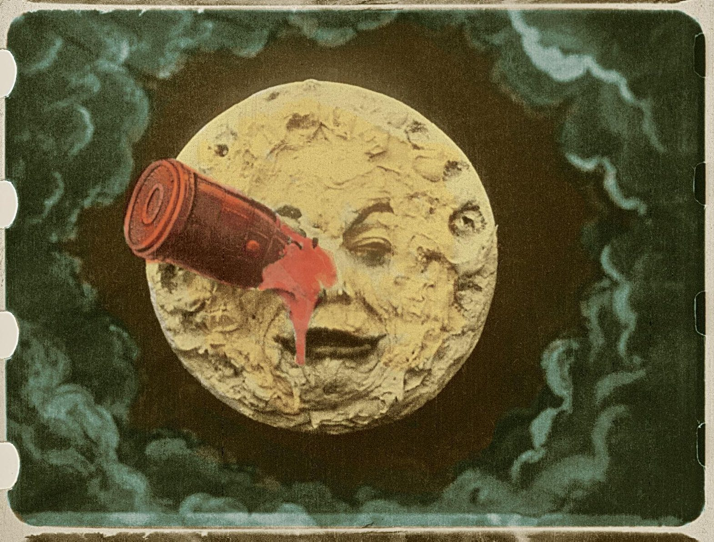
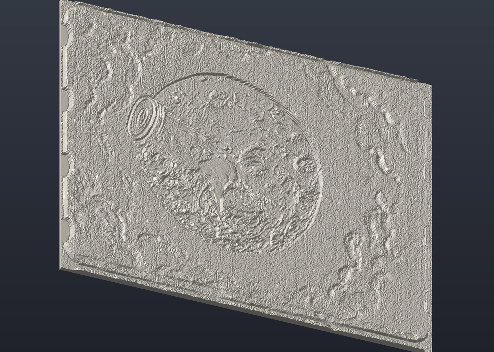

# Lithophane builder

Turn any photo into a 3D-printable **lithophane**: a thin plastic panel whose
varying thickness reveals the picture when you hold it up to a light.

`lithophane-builder` is a dependency-free Go command-line tool that converts a
JPEG, PNG, or GIF image into a flat lithophane in binary STL format, ready to
load into any slicer. Animated GIFs use their first frame.

## Why

Lithophane generators usually live inside web apps or slicer plugins. This tool
does the same job from the command line, with no runtime dependencies, so it is
easy to script, batch, or run offline, and it always produces a closed,
watertight mesh that slicers accept without repair.

## How it works

The image is converted to grayscale, then mapped to plastic thickness: black is
thickest and white is thinnest. When lit from behind, thin areas transmit more
light, reproducing the image. Transparent areas are composited onto white.

## Example

Source image (a frame from Georges Méliès' *A Trip to the Moon*, 1902):



```sh
go run . -input docs/source.png -output moon.stl -width 120 -step 0.3
# Created moon.stl: 120.00 × 91.26 mm, 0.80–3.00 mm thick, 490820 triangles
```

Resulting STL, rendered from the relief side. Dark areas of the image become
raised, thicker plastic; bright areas stay thin:



Printed in white filament and lit from behind, the thickness differences turn
back into the original picture in shades of light.

## Run

Requires Go 1.22 or later.

```sh
go run . -input photo.jpg -output lithophane.stl
```

Or build the executable:

```sh
go build -o lithophane-builder .
./lithophane-builder -input photo.png -output panel.stl -width 150 -step 0.3 -min-thickness 0.8 -max-thickness 3
```

| Flag | Default | Meaning |
| --- | --- | --- |
| `-input` | Required | JPEG, PNG, or GIF path |
| `-output` | `lithophane.stl` | Destination file (replaces an existing file) |
| `-width` | `100` | Panel width in mm; height preserves the image aspect ratio |
| `-step` | `0.5` | Maximum mesh spacing in mm |
| `-min-thickness` | `0.8` | White-pixel thickness in mm |
| `-max-thickness` | `3` | Black-pixel thickness in mm |
| `-invert` | `false` | Reverse brightness-to-thickness mapping |

All dimensions must be positive, and maximum thickness must be at least minimum
thickness. Smaller mesh spacing increases detail, processing time, and file size.
The mesh is limited to 1,000,000 vertices per surface; increase `-step` if needed.

## Geometry and printing

The panel lies in the XY plane, with a flat back at Z=0 and the image relief on
the positive Z side. The image top faces positive Y when viewed from the front.
Grayscale values are bilinearly sampled onto the mesh. Front, back, and side
walls form a closed solid with outward-facing normals. There is no added frame
or stand. STL does not encode units; import the model into your slicer as mm.

Start with white or natural translucent filament, and tune thickness for your
material and backlight. In the slicer, use solid infill and orient the panel for
your printer. The image should read correctly when viewed from the relief side.

## Verify

```sh
go test ./...
go vet ./...
```

Tests check brightness mapping, transparency, image orientation, aspect ratio,
STL size, normals, signed volume, watertight edges, and invalid inputs.
